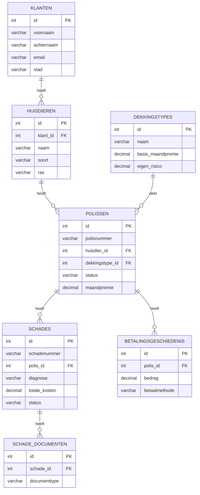

# Dierenverzekering — tabellen & relaties

Schema zoals aangemaakt door `docker/init.sql`.



## Join-pad

De tabellen vormen één keten — elke stap koppelt via een foreign key aan de vorige:

```
klanten (id) ←── huisdieren (klant_id)
huisdieren (id) ←── polissen (huisdier_id)
dekkingstypes (id) ←── polissen (dekkingstype_id)
polissen (id) ←── schades (polis_id)
polissen (id) ←── betalingsgeschiedenis (polis_id)
schades (id) ←── schade_documenten (schade_id)
```

Dus om bijvoorbeeld van een **schade** terug te komen bij een **klant**, loop je de keten omhoog:
`schades → polissen → huisdieren → klanten`.
